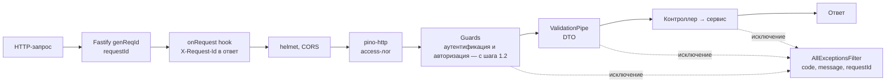

# Шаг 0. Инфраструктура проекта

Это фундамент, на котором строятся все задания: локальное окружение, логи, единый формат ошибок, документация API, почта, health-проверки и тесты.

## Что сделано

| Что | Где | Зачем |
|---|---|---|
| Docker-окружение: Postgres (порт **5433**), Mailpit | `docker-compose.yml`, `docker/postgres/init/` | БД и «фальшивый» SMTP поднимаются одной командой. Отдельная БД `app_test` нужна для e2e |
| Конфиг: новые переменные (`LOG_LEVEL`, `SWAGGER_ENABLED`, `SMTP_*`) | `src/core/config/*` | Joi проверяет env при старте; `ConfigService.get()` типизирован |
| Request ID | `src/core/logger/request-id.ts` | Каждый запрос получает id, он возвращается в `X-Request-Id` и пишется в логи |
| Структурные логи (pino) | `src/core/logger/logger.module.ts` | JSON-логи с методом, путём, статусом, длительностью и requestId, секреты вырезаны |
| Единый формат ошибок | `src/core/errors/*` | `{code, message, requestId}`, без stack trace и деталей БД |
| Общая настройка приложения | `src/core/app/app.setup.ts` | helmet, compression, CORS, cookies, `ValidationPipe`, фильтр, Swagger. Используется и в `main.ts`, и в тестах |
| Swagger / OpenAPI | `/docs`, `/docs-json` | Документация из декораторов. В production выключена по умолчанию |
| Почта: порт и адаптер | `src/core/mail/*` | `MailSender` — абстракция, `SmtpMailSender` — реализация на Nodemailer |
| Криптопримитивы | `src/core/crypto/crypto.util.ts` | HMAC-SHA256, сравнение за постоянное время, OTP, случайные токены |
| Health | `/health/live`, `/health/ready` | Liveness — процесс жив. Readiness — готов принимать трафик (БД и проверки модулей) |
| Планировщик | `ScheduleModule` в `AppModule` | Понадобится для фоновых воркеров (1.5, 1.6, 2.3, 2.4) |
| Тесты | `src/**/*.spec.ts`, `test/` | Unit- и e2e-тесты, общее покрытие ≈ 99% |

### Исправленные ошибки шаблона

- В e2e-тесте была проверка несуществующего маршрута `GET /` → "Hello World", и тест использовал Express вместо Fastify.
- В Jest не было маппинга алиаса `@/` → любой unit-тест с импортом `@/...` падал.
- Unit-тесты health и config не давали зависимостей → падали на старте.
- `src/database/data-source.ts` экспортировал DataSource дважды (named и default), из-за этого TypeORM CLI отказывался работать.
- Шаблон миграций (`*.migration.ts`) не совпадал с тем, что генерирует CLI. Теперь имя задаётся так: `npm run migration:generate --name=CreateUsers` → `…-CreateUsers.migration.ts`.
- CLI TypeORM не понимал алиасы `@/`. Добавлен `-r tsconfig-paths/register`.
- `ConfigService.get()` возвращал всё как `string`. Флаг `HEALTH_CHECK_ENABLED=false` из-за этого превращался в строку `"false"`, а она в `if` — истина.

## Как устроен путь запроса



## Ключевые решения и почему

1. **Fastify, а не Express.** Его выбрал шаблон. Fastify быстрее и строже по типам, но из-за этого везде используются `FastifyReply` и `app.register(...)`, а не Express-middleware.
2. **Request ID принимаем от клиента только «безопасный»:** `[A-Za-z0-9._-]{1,128}`. Иначе через заголовок можно внедрить в лог фальшивые строки (log injection).
3. **Логи без секретов.** Сериализатор пишет только метод, путь без query, статус и requestId. Cookies и `Authorization` дополнительно вырезаются через `redact`.
4. **Ошибки.** Бизнес-код бросает `AppException(status, code, message, extra)`, а фильтр превращает его в ответ. Неожиданное исключение становится 500 `internal_error` без деталей, а подробности уходят в лог с тем же requestId.
5. **`forbidNonWhitelisted: true`.** Лишнее поле в теле или query даёт 400. Спека требует отклонять неизвестные поля (1.5, 1.7, 2.x).
6. **Порты и адаптеры для внешнего мира** (глава 0.3). Почта — абстрактный класс `MailSender`, потому что TS-интерфейс исчезает в рантайме и не может быть DI-токеном. В тестах его подменяют фейком.
7. **Readiness расширяемый.** Модули сами регистрируют проверки в `ReadinessRegistry`: снимок RBAC, ключи JWT, декларации маршрутов. HealthModule о них не знает.
8. **e2e-тесты используют ту же `configureApp`, что и прод,** и отдельную БД `app_test`. `test/setup-env.ts` подгружает `.env.test` поверх `.env`.

## Как запустить

```bash
docker compose up -d
```

```bash
cp .env.example .env && cp .env.test.example .env.test
```

```bash
npm run start:dev
```

- API: http://localhost:3007, Swagger: http://localhost:3007/docs
- Письма: http://localhost:8025 (Mailpit)
- Запросы для ручной проверки: `http/0-infrastructure.http`

```bash
npm run test:cov:all
```

## Вероятные вопросы на ревью

**Зачем requestId, если есть timestamp?**
В один момент времени параллельно идут сотни запросов, их строки лога перемешаны. RequestId связывает все строки одного запроса, а клиент может назвать его поддержке.

**Чем liveness отличается от readiness?**
Liveness отвечает на вопрос, жив ли процесс. Если нет, оркестратор его перезапускает. Readiness отвечает на вопрос, можно ли слать трафик. Если нет, трафик не идёт, но процесс не убивают. Если упала БД, перезапуск приложения не поможет, поэтому БД проверяется только в readiness.

**Почему клиенту не отдаётся текст исключения?**
Stack trace и сообщения библиотек раскрывают внутреннее устройство: версии, таблицы, пути. Клиенту нужен только стабильный `code`, а детали лежат в логе под тем же requestId.

**Зачем `code`, если есть HTTP-статус?**
Один статус покрывает разные ситуации. Например, 401 бывает `invalid_credentials` и `invalid_session`, и клиент реагирует на них по-разному.

**Почему `MailSender` — абстрактный класс, а не interface?**
TypeScript-интерфейсы стираются при компиляции, а Nest DI нужен рантайм-токен. Абстрактный класс одновременно и контракт, и токен.

**Почему e2e идут в отдельную БД?**
Тесты создают и удаляют данные. Если гонять их на базе разработки, она превращается в мусор, а тесты начинают зависеть от её состояния.

**Почему Postgres на 5433?**
Порт 5432 на машине занят Postgres другого проекта. Внутри контейнера порт по-прежнему 5432, меняется только проброс на хост.

## Что отложено

- S3-совместимое хранилище перенесено на шаг 1.4. Публичные образы MinIO больше не раздаются через Docker Hub, альтернативу выберем там.
- Список CORS-origin пока захардкожен. В конфиг он переедет на шаге 1.2, вместе с CSRF-проверкой.
