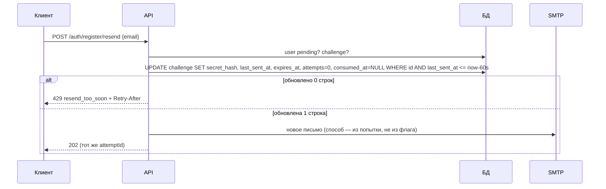

# Задание 1.0. Регистрация

Гость создаёт аккаунт по email и паролю. Если подтверждение выключено, аккаунт сразу активен. Если включено, пользователь ждёт кода (OTP) или ссылки (magic link) из письма. Способ выбирает сервер. Пароль хранится только как медленный хеш Argon2id. Повторно зарегистрировать тот же email нельзя, даже если аккаунт ещё ждёт подтверждения.

## Что сделано

| Что | Где | Зачем |
|---|---|---|
| Таблица `users` | `src/modules/users/user.entity.ts` | email (уникальный индекс `UQ_users_email`), `password_hash` (`select: false`), `status` `pending`/`active` |
| Таблица `registration_challenges` | `src/modules/auth/registration/registration-challenge.entity.ts` | одна попытка на пользователя. В ней HMAC секрета, TTL, счётчик, время отправки и погашения. CHECK-ограничения на счётчик и на `expires_at` |
| Миграция | `src/database/migrations/…-CreateUsersAndRegistrationChallenges.ts` | сгенерирована CLI, проверены `run`, `revert` и повторный `run`, повторная генерация не находит изменений |
| `UsersService` | `src/modules/users/users.service.ts` | `createActive`, `createPending`, `activate`. Конфликт уникального индекса превращается в 409 |
| Точка расширения RBAC | `src/modules/users/user-activation.hook.ts` | `UserActivationHook.onActivated(userId)` вызывается в транзакции активации. Сейчас подключён Noop |
| Хеширование пароля | `src/modules/auth/password/password-hasher.ts` | Argon2id, m=19 MiB, t=2, p=1 (минимум OWASP) |
| Политика пароля | `src/modules/auth/password/password-policy.ts` | 8–128 символов Unicode, буква `\p{L}`, цифра `\p{Nd}`, без `trim` |
| HMAC секретов | `src/modules/auth/registration/challenge-secrets.ts` | генерация OTP и токена, HMAC с разделением доменов, сравнение за постоянное время |
| Логика | `src/modules/auth/registration/registration.service.ts` | register, confirm, resend |
| HTTP | `src/modules/auth/registration/registration.controller.ts` | `POST /auth/register`, `/confirm`, `/resend`, описание в Swagger |
| Настройки сценария | `src/modules/auth/registration/registration.settings.ts` | флаг и способ подтверждения, URL ссылки. Это точка замены на будущий модуль настроек |
| Rate limit | `src/core/throttler/*` | именованный лимит `registration` включается декоратором. 429 `rate_limited` с `Retry-After` |
| Аудит | `src/core/audit/*`, `registration-audit.interceptor.ts` | события `registration.*` без секретов и без email |
| `Retry-After` | `src/core/errors/all-exceptions.filter.ts` | если в ошибке есть `retryAfterSeconds`, фильтр дублирует его в заголовок |
| Конфиг | `src/core/config/*`, `.env.example` | `CHALLENGE_HMAC_KEY` (обязателен, ≥ 32 символов, заглушка запрещена), `REGISTRATION_*` |
| Тесты | `src/**/*.spec.ts`, `test/registration*.e2e-spec.ts` | 138 unit- и 44 e2e-теста, общее покрытие ≈ 97% строк |
| Демонстрация | `http/1.0-registration.http` | все сценарии и ошибки для REST Client или HTTP Client |

### Исправления шага 0, найденные здесь

- **Генерация миграций.** Скрипт создавал файл `…-Name.migration.ts`, и TypeORM брал имя класса из имени файла: `class Name.migration123`. Это невалидный TypeScript. Теперь файлы называются `<timestamp>-<Name>.ts`, а glob миграций — `migrations/*{.ts,.js}`. Файлы `.d.ts` из `dist` TypeORM отбрасывает сам.
- **ThrottlerModule.** Модуль был подключён, но guard нигде не стоял, поэтому лимиты не действовали. Теперь `AppThrottlerGuard` стоит на контроллере регистрации.
- **`AuthModule`.** Модуль не был импортирован в `AppModule`.

## API

| Операция | Успех | Ошибки |
|---|---|---|
| `POST /auth/register` `{email, password}` | **201** `{id, email, status: "active"}` или **202** `{confirmationRequired: true, method, attemptId, expiresInSeconds: 600, resendAfterSeconds: 60}` | 400 `validation_failed`, 409 `email_taken`, 429 `rate_limited`, 503 `mail_delivery_failed` (+ `attemptId`, `resendAfterSeconds`) |
| `POST /auth/register/confirm` `{attemptId, code}` или `{token}` | **200** `{id, email, status: "active"}` | 400 `validation_failed` / `confirmation_invalid` / `confirmation_expired`, 429 `attempts_exhausted` |
| `POST /auth/register/resend` `{email}` | **202**, тело как у регистрации | 400 `validation_failed` / `confirmation_invalid`, 429 `resend_too_soon` / `rate_limited` (+ `retryAfterSeconds`, `Retry-After`), 503 |

Все ошибки приходят в едином формате: `{ code, message, requestId, ...extra }`.

## Поток

### Без подтверждения

```mermaid
sequenceDiagram
  participant C as Клиент
  participant A as API
  participant D as БД
  C->>A: POST /auth/register {email, password}
  A->>A: ValidationPipe: нормализация email, политика пароля
  A->>D: SELECT по email (быстрый отказ 409)
  A->>A: Argon2id(password)
  A->>D: BEGIN; INSERT users(active); хук «роль user»; COMMIT
  A-->>C: 201 {id, email, status: active}
```

### С подтверждением (OTP или magic link)

```mermaid
sequenceDiagram
  participant C as Клиент
  participant A as API
  participant D as БД
  participant M as SMTP (Mailpit)
  C->>A: POST /auth/register
  A->>A: Argon2id(password), секрет = 6 цифр или 32 байта
  A->>D: BEGIN; INSERT users(pending); INSERT challenge(HMAC секрета); COMMIT
  A->>M: письмо с кодом или ссылкой ...#token=
  alt SMTP принял
    A-->>C: 202 {confirmationRequired, method, attemptId, 600, 60}
  else SMTP упал
    A-->>C: 503 mail_delivery_failed {attemptId}. pending и попытка сохранены
  end
  C->>A: POST /auth/register/confirm {attemptId, code} или {token}
  A->>D: BEGIN; SELECT challenge ... FOR UPDATE
  alt не найдена / погашена успехом
    A-->>C: 400 confirmation_invalid
  else погашена 5-м неверным
    A-->>C: 429 attempts_exhausted
  else просрочена
    A-->>C: 400 confirmation_expired (счётчик не растёт)
  else неверный код
    A->>D: attempts+1 (на 5-м consumed_at = now); COMMIT
    A-->>C: 400 confirmation_invalid
  else верно
    A->>D: consumed_at = now; users → active; хук «роль user»; COMMIT
    A-->>C: 200 {id, email, status: active}
  end
```

### Повторная отправка



## Ключевые решения

1. **Транзакция confirm возвращает исход, а не бросает исключение.** Исключение внутри `@Transactional()` откатило бы `attempts + 1`, и лимит в 5 попыток никогда бы не сработал. Поэтому транзакция фиксируется, а 400 или 429 бросается уже снаружи.
2. **`SELECT … FOR UPDATE` в confirm.** Параллельные неверные вводы выстраиваются в очередь. e2e-тест шлёт 8 одновременных неверных кодов и получает ровно 5 ответов 400 и 3 ответа 429.
3. **«Погашена» различается по счётчику.** Если `consumed_at` задан и `attempts ≥ 5`, лимит исчерпан (429). Если `consumed_at` задан, а счётчик меньше, попытка уже использована (400). Отдельный столбец для этого не нужен.
4. **HMAC с разделением доменов.**
   - Для OTP считается `HMAC(key, "registration:otp:<attemptId>:<code>")`. У одинаковых кодов разных пользователей получаются разные хеши.
   - Для ссылки считается `HMAC(key, "registration:magic_link:<token>")`.
   - Ключ может быть общим с будущими сценариями (1.5), контексты разделены префиксом. Вход (1.2) по своей спеке получил отдельный ключ `LOGIN_CHALLENGE_HMAC_KEY`.
5. **Поиск по токену всегда идёт с фильтром `method = 'magic_link'`.** Это защита в глубину. Уже сейчас `{ token }` не совпадёт с OTP-попыткой: у хешей разные префиксы, а токен обязан быть 43 символа. Но если префиксы или формат когда-нибудь поменяют, без фильтра можно было бы искать по хешу среди OTP-попыток в обход лимита в 5 вводов. Частичный индекс `IDX_registration_challenges_magic_link_secret` покрывает именно этот запрос.
6. **Resend сделан условным UPDATE.** Проверку «прошло ли 60 с» выполняет сама БД атомарно: из трёх параллельных resend письмо уходит один раз. Все зависимые поля (`last_sent_at`, `expires_at`, `secret_hash`, `attempts`, `consumed_at`) меняются одним UPDATE.
7. **CHECK `expires_at = last_sent_at + 600 s`.** Спека отмечает, что таблица формально во 2NF и допускает аномалию обновления. Ограничение в БД делает такую аномалию невозможной в принципе.
8. **Письмо отправляется после COMMIT.** Пока идёт сетевой вызов SMTP, транзакция не держится. При сбое данные уже сохранены, и клиент получает 503 с `attemptId`. Кулдаун 60 с действует и после неудачной отправки: при упавшем SMTP клиенты не забьют его повторами.
9. **Способ подтверждения выбирает сервер.** Флаг читается в момент регистрации. Confirm и resend используют `method` из попытки, поэтому выключенный позже флаг не ломает уже выданные попытки.
10. **Activation hook.** Активация и назначение роли выполняются в одной транзакции, и `typeorm-transactional` передаёт её через AsyncLocalStorage. e2e-тест доказывает откат: если хук бросает исключение, пользователь остаётся `pending`, а попытка не погашена.
11. **Rate limit включается явно.** ThrottlerGuard применяет каждый именованный лимит к каждому маршруту, поэтому лимит `registration` пропускается через `skipIf` везде, где нет `@RateLimitOn(RateLimit.Registration)`. У register и resend отдельные счётчики (ключ включает имя метода), confirm защищён лимитом в 5 попыток.
12. **Токен magic link передаётся во фрагменте `#token=`.** Фрагмент не уходит на сервер, в Referer и в логи прокси. GET-маршрута confirm нет вообще.

## Точка расширения: роль `user` при активации (для 1.1)

`UsersService` вызывает `UserActivationHook.onActivated(userId)` в двух местах. Оба вызова идут внутри `@Transactional()`:
- `createActive`: регистрация без подтверждения;
- `activate`: успешный confirm. Хук срабатывает, только если UPDATE `pending → active` затронул строку, поэтому повтор не назначит роль дважды.

Сейчас подключён `NoopUserActivationHook`. Спека это разрешает: пока RBAC нет, активные пользователи получат роль при первой загрузке пустой конфигурации RBAC. В 1.1 модуль RBAC реализует хук через `INSERT INTO user_roles … ON CONFLICT DO NOTHING`, и в `UsersModule` поменяется только одна строка:

```ts
{ provide: UserActivationHook, useExisting: RbacUserActivationHook }
```

Ошибка в хуке откатит и активацию: это проверяют два e2e-теста.

## Аудит

Каждая запись — JSON-строка pino с контекстом `Audit`. В неё автоматически попадает `requestId`.

| Событие | Поля | Когда |
|---|---|---|
| `registration.succeeded` | `userId`, `status`, `attemptId?`, `method?` | создан active или pending |
| `registration.failed` | `reason`: `email_taken` / `validation_failed`, `existingUserId?` | отказ при регистрации |
| `registration.confirmation.sent` | `userId`, `attemptId`, `method`, `trigger`: `register` / `resend` | письмо принято SMTP |
| `registration.confirmation.send_failed` | то же | SMTP отказал (503) |
| `registration.confirmation.succeeded` | `method`, `attemptId`, `userId` | аккаунт активирован |
| `registration.confirmation.failed` | `method`, `attemptId?`, `reason`: `not_found` / `already_used` / `wrong_secret` / `expired` / `attempts_exhausted` / `validation_failed`, `attempts?` | неуспешное подтверждение |
| `registration.resend.failed` | `reason`: `not_found` / `not_pending` / `too_soon` / `validation_failed` | отказ resend |
| `rate_limit.exceeded` | `handler`, `retryAfterSeconds` | сработал rate limit |

В журнал **не попадают** пароль, хеш пароля, код, токен, тело запроса и email. Email — персональные данные. По `userId` его можно найти в БД, у которой доступ строже, чем у логов. Типы `AuditFields` разрешают только примитивы, поэтому сущность целиком «случайно» в лог не передать. Дополнительно pino вырезает поля `*.password`, `*.passwordHash`, `*.token`, `*.secretHash`.

## Конфигурация

| Переменная | По умолчанию | Смысл |
|---|---|---|
| `CHALLENGE_HMAC_KEY` | — (обязательна) | ключ HMAC, ≥ 32 символов. Сгенерировать: `openssl rand -base64 48` |
| `REGISTRATION_CONFIRMATION_ENABLED` | `false` | флаг сценария «регистрация» |
| `REGISTRATION_CONFIRMATION_METHOD` | `otp` | `otp` или `magic_link` |
| `REGISTRATION_CONFIRM_URL` | `http://localhost:5174/register/confirm` | страница фронтенда для magic link |
| `REGISTRATION_RATE_LIMIT` / `REGISTRATION_RATE_TTL` | `5` / `60000` | запросов с IP за окно (мс) на register и на resend |

TTL 600 с, кулдаун 60 с и лимит в 5 попыток — это контракт API (клиент получает их в ответе), поэтому они заданы константами в `registration.constants.ts`.

## Как проверить

```bash
docker compose up -d
```

```bash
npm run start:dev
```

Дальше — запросы из `http/1.0-registration.http`, письма в Mailpit: http://localhost:8025.

```bash
npm run test:cov:all
```

## Вероятные вопросы ревьюера

**1. Почему проверка «email занят» есть и в коде, и в БД?**
SELECT перед INSERT экономит Argon2 (десятки мс CPU) на очевидных повторах, но гонку не закрывает: два запроса одновременно увидят «свободно». Закрывает её уникальный индекс. Ошибку 23505 по `UQ_users_email` мы превращаем в 409. Есть e2e-тест на три параллельные регистрации: ответы 201, 409 и 409, ни одного 500.

**2. Почему Argon2id, а не bcrypt?**
Argon2id — memory-hard функция: каждый хеш требует 19 MiB памяти, и GPU-перебор становится дорогим. Его рекомендует OWASP. У bcrypt лимит 72 байта, всё после них молча обрезается. У Argon2 такого лимита нет, но длину пароля мы всё равно ограничиваем 128 символами, чтобы защититься от DoS дорогим хешированием.

**3. Зачем HMAC, если код живёт 10 минут?**
При утечке БД голый SHA-256 от 6 цифр перебирается за доли секунды, а пока попытка жива, найденным кодом можно активировать чужой аккаунт. HMAC без ключа из конфигурации не посчитать. Спека прямо требует, чтобы секрет нельзя было восстановить из базы.

**4. Почему OTP ищется по `attemptId`, а не по хешу кода?**
Кодов миллион. Поиск «по хешу среди всех попыток» дал бы атакующему совпадение с чьей-нибудь попыткой примерно за миллион запросов, а с ростом числа пользователей — ещё быстрее. Поиск по id привязывает перебор к одной попытке с лимитом в 5 вводов. Шанс угадать — 5 из миллиона.

**5. Не обходится ли лимит параллельными запросами?**
Нет. Строка попытки блокируется `SELECT … FOR UPDATE`, и проверка вместе с инкрементом идёт в одной транзакции. Это проверяет e2e-тест.

**6. Почему неверный код не бросает исключение в транзакции?**
Бросок откатил бы `attempts + 1`. Поэтому транзакция возвращает исход (`invalid`, `expired`, `exhausted`, `confirmed`), фиксируется, и только потом сервис бросает AppException.

**7. Почему `confirmation_expired` отличается от `confirmation_invalid`, если спека говорит «400»?**
Статус один и тот же: 400. Разный код помогает клиенту: при просрочке он предлагает «выслать новый код», а не «проверьте код». Узнать по нему ничего нельзя: чтобы увидеть «expired», нужен реальный `attemptId` (он и так у клиента) или реальный токен.

**8. Почему 409, а не нейтральный ответ?**
Спека: «По умолчанию используется явный 409». Нейтральный режим скрыл бы, что email зарегистрирован (защита от перечисления аккаунтов), но потребовал бы такого же ответа и от resend. Реализовать его можно отдельным флагом в `RegistrationSettings`.

**9. Что если SMTP недоступен?**
Ответ 503 `mail_delivery_failed` с `attemptId`. Пользователь `pending` и попытка остаются в базе (письмо отправляется после COMMIT). Повторная регистрация вернёт 409, новое письмо выдаёт resend через 60 с. Таймауты SMTP-клиента (5–10 с) не дают запросу зависнуть.

**10. Почему активация по ссылке идёт через POST?**
Почтовые сканеры (антивирусы, Outlook Safe Links) и превью мессенджеров сами открывают ссылки методом GET. Если бы GET активировал аккаунт, одноразовый токен израсходовал бы робот. Кроме того, GET по семантике HTTP безопасен и не должен менять состояние.

**11. Где роль `user`?**
См. раздел «Точка расширения». Хук вызывается в той же транзакции, сейчас подключён Noop. Спека разрешает так делать до появления RBAC.

**12. Почему флаг вынесен в `RegistrationSettings`, а не читается через `config.get`?**
Спека говорит: «пока нет модуля настроек». Значит, источник флага поменяется, и тогда изменится один класс. Кроме того, в e2e можно переключать флаг между тестами без пересборки приложения.

**13. Rate limit в памяти — это нормально?**
Для одного экземпляра — да. При горизонтальном масштабировании нужно общее хранилище (Redis, `ThrottlerStorage`), иначе лимит умножается на число экземпляров. За обратным прокси нужно включить `trustProxy`, чтобы трекером был IP клиента, а не IP прокси.

**14. Почему email не пишется в аудит?**
Email — персональные данные, а логи читает больше людей и систем, чем БД. Для расследования хватает `userId` и `requestId`.

**15. Почему `password_hash` помечен `select: false`?**
Чтобы хеш не загружался без явного запроса и случайно не утёк в ответ API или в лог. Для входа (1.2) хеш запросят явно через `addSelect`.

**16. Почему у CHECK для `expires_at` такое строгое равенство?**
Это прямая реализация зависимости из спеки. Аномалия «обновили `last_sent_at`, забыли `expires_at`» становится ошибкой БД, а не тихим багом. Если TTL когда-нибудь изменится, понадобится миграция, и это правильно: TTL — часть контракта.
