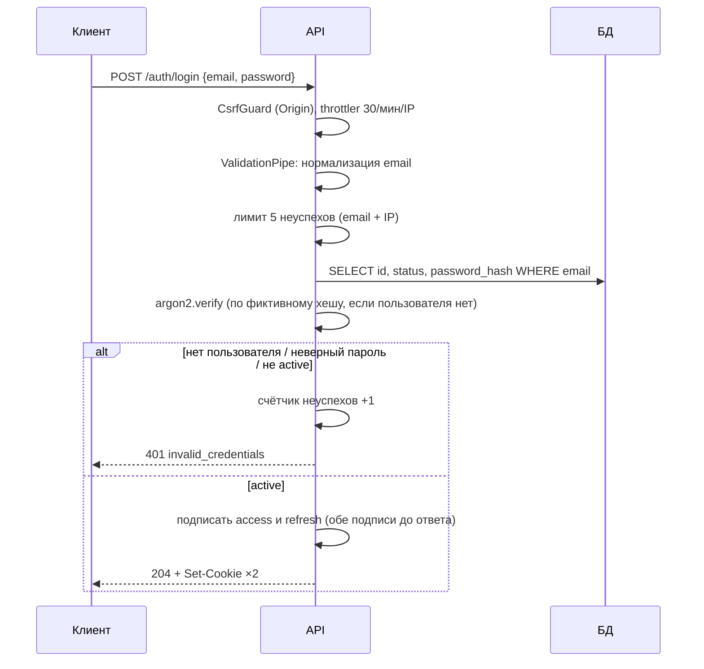
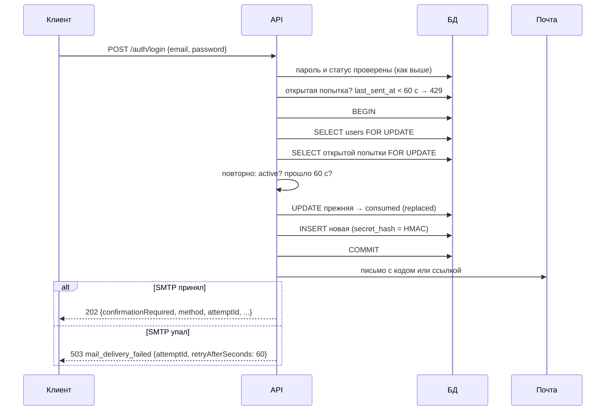
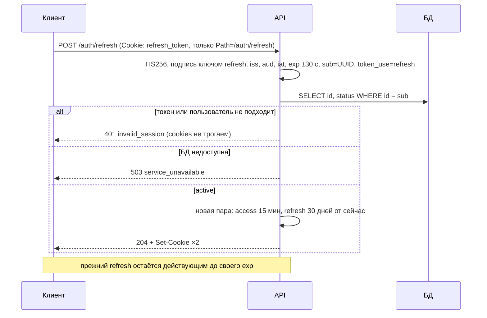

# Задание 1.2. Аутентификация

Гость входит по email и паролю. Если подтверждение входа выключено, сервер сразу ставит две HttpOnly-cookie: `access_token` (JWT на 15 минут) и `refresh_token` (JWT на 30 дней). Если включено, после верного пароля сервер отправляет на почту код (OTP) или ссылку (magic link), и cookies выдаются только после подтверждения. Refresh выдаёт новую пару без пароля, logout очищает cookies. Сессий на сервере нет (stateless). Каждый access и refresh принимается только для существующего пользователя в статусе `active`.

## Что сделано

| Что | Где | Зачем |
|---|---|---|
| Таблица `login_challenges` | `src/modules/auth/login/login-challenge.entity.ts` | попытка подтверждения входа. Без `expires_at` (BCNF), `consumed_reason`, частичный уникальный индекс «одна открытая попытка на пользователя», 3 CHECK |
| Новые статусы | `src/modules/users/user.entity.ts` | `blocked`, `deleting`, `deleted` (сценарий 7 спеки). Код пропускает только `active` |
| Миграция | `src/database/migrations/1794823342520-CreateLoginChallenges.ts` | сгенерирована CLI. Проверено: `run` → `revert` → `run`, повторный `generate` даёт «No changes» |
| `UsersService` | `src/modules/users/users.service.ts` | `findForLogin` (с `password_hash`), `findAuthState` (только `id`, `status`), `lockForAuth` (`FOR UPDATE`) |
| JWT | `src/modules/auth/tokens/token.service.ts` | выпуск и проверка HS256, категории отказа, readiness-проверка `auth-tokens` |
| Cookies | `src/modules/auth/tokens/auth-cookies.ts` | одинаковые атрибуты для установки и очистки |
| Сессия | `src/modules/auth/session/session.service.ts` | проверка токена и пользователя, refresh |
| Проверка access | `src/modules/auth/session/access.guard.ts`, `current-user.decorator.ts` | `@UseGuards(AccessGuard)` и `@CurrentUserId()` для защищённых маршрутов (1.4, 1.1) |
| Refresh и logout | `src/modules/auth/session/session.controller.ts` | `POST /auth/refresh`, `POST /auth/logout` |
| Вход | `src/modules/auth/login/login.service.ts`, `login.controller.ts` | `POST /auth/login`, `/confirm`, `/resend` |
| HMAC попыток | `src/modules/auth/login/login-challenge-secrets.ts` | отдельный ключ `LOGIN_CHALLENGE_HMAC_KEY`, префикс `login:<method>:<attemptId>:` |
| Лимит неуспехов | `src/modules/auth/login/login-failure-limiter.ts` | 5 неуспешных проверок на пару email + IP за 15 минут |
| Rate limit | `src/core/throttler/*` | именованные лимиты `login` и `refresh`: 30 запросов с IP за минуту |
| Origin/CSRF | `src/core/security/csrf.guard.ts` | глобальный guard на POST/PUT/PATCH/DELETE, 403 `csrf_rejected` |
| CORS | `src/core/app/app.setup.ts` | точный список `TRUSTED_ORIGINS` из конфигурации, credentials, заголовок `X-CSRF-Protection` |
| 503 при недоступной БД | `src/core/database/pg-errors.ts`, `all-exceptions.filter.ts` | `isDatabaseUnavailable` → 503 `service_unavailable`, а не 500 и не 401 |
| Логи без секретов | `pg-errors.ts` (`describeQueryError`), `logger.module.ts` | ошибка SQL пишется без значений параметров, расширен `redact` |
| Служебный id email | `src/core/audit/audit-ids.ts` | `HMAC(AUDIT_HMAC_KEY, email)` для журнала и ключа лимитера |
| Конфиг | `src/core/config/*`, `.env.example` | 4 ключа (≥ 32 байт, заглушки запрещены, попарно разные), `JWT_ISSUER/AUDIENCE`, `LOGIN_*`, `APP_ORIGIN`, `TRUSTED_ORIGINS`, `AUTH_COOKIE_SAME_SITE` |
| Тесты | `src/**/*.spec.ts`, `test/login.e2e-spec.ts`, `test/session.e2e-spec.ts`, `test/auth-rate-limit.e2e-spec.ts` | см. «Как проверить» |
| Демонстрация | `http/1.2-authentication.http` | сценарии для экзамена |

### Решения там, где спека оставляет выбор

- **Запрос без `Origin` проходит CSRF-проверку.** Браузер ставит `Origin` на любой cross-origin запрос и на любой POST. Его отсутствие значит «не браузер»: curl, мобильное приложение, сервер. Там нет чужой страницы, которая отправила бы запрос с cookie жертвы. `Origin: null` — это браузер, его отклоняем.
- **CSRF-guard глобальный** и стоит на всех изменяющих методах, включая регистрацию 1.0. Спека: «все POST-запросы из другого origin».
- **Защищённых маршрутов в 1.2 нет** (профиль появится в 1.4). AccessGuard проверяется тестовым контроллером, который объявлен только в `test/session.e2e-spec.ts`. В API маршрутов вне спеки нет.
- **Resend для неактивного пользователя** гасит попытку как `user_inactive` и отвечает 401 `invalid_credentials`. Так же ведёт себя confirm (шаг 4). Для resend спека код не называет.
- **Успешный вход не сбрасывает счётчик неуспехов.** Спека ограничивает число неуспешных проверок за 15 минут, успешный вход между ними этого числа не меняет.
- **Пороги `login` и `refresh` вынесены в env** со значениями спеки по умолчанию (30 за 60 с). Это нужно только тестам: `.env.test` поднимает их, а `test/auth-rate-limit.e2e-spec.ts` проверяет значения спеки.
- **Коды ошибок**, которых спека не называет: `confirmation_invalid` (как в 1.0), `attempts_exhausted`, `resend_too_soon`, `rate_limited`, `mail_delivery_failed`, `token_signing_failed`, `service_unavailable`.

### Secure-cookie на http://localhost: отступление не понадобилось

Спека требует `Secure`, а локально API работает по HTTP. Проверено на практике:
- **curl 8.7.1** с cookie jar после login отправил cookie на `POST http://localhost:3007/auth/refresh` и получил 204. curl считает `localhost` безопасным origin. На `127.0.0.1` cookie не уходит, но её туда и не ставили: cookie host-only, привязана к `localhost`;
- **Chromium** (встроенный браузер): `fetch` login → refresh → logout → refresh дал 204 → 204 → 204 → 401, а `document.cookie` пуст (HttpOnly). Браузеры считают `http://localhost` защищённым контекстом.

Поэтому dev-флага для отключения `Secure` нет. Если какой-то клиент (например, Postman) не отправит такую cookie на `http://localhost`, правильное решение — локальный HTTPS, а не флаг, который однажды доедет до production.

## API

| Операция | Успех | Ошибки |
|---|---|---|
| `POST /auth/login` `{email, password}` | **204** + 2 `Set-Cookie`, или **202** `{confirmationRequired: true, method, attemptId, expiresInSeconds: 600, resendAfterSeconds: 60}` | 400 `validation_failed`, 401 `invalid_credentials`, 403 `csrf_rejected`, 429 `rate_limited` / `resend_too_soon`, 503 `mail_delivery_failed` (+ `confirmationRequired`, `method`, `attemptId`, `retryAfterSeconds`) / `token_signing_failed` / `service_unavailable` |
| `POST /auth/login/confirm` `{attemptId, code}` или `{token: "<attemptId>.<secret>"}` | **204** + 2 `Set-Cookie` | 400 `validation_failed` / `confirmation_invalid`, 401 `invalid_credentials`, 403, 429 `attempts_exhausted`, 503 |
| `POST /auth/login/resend` `{attemptId}` | **202** `{method, attemptId, expiresInSeconds, resendAfterSeconds}` | 400, 401, 403, 429 `resend_too_soon` / `attempts_exhausted`, 503 `mail_delivery_failed` |
| `POST /auth/refresh` (cookie `refresh_token`) | **204** + новая пара | 401 `invalid_session`, 403, 429 `rate_limited`, 503 |
| `POST /auth/logout` | **204** + 2 очищающие `Set-Cookie`, всегда | 403 `csrf_rejected` |

Cookies:

```text
access_token=<JWT>;  Max-Age=900;     Path=/;             HttpOnly; Secure; SameSite=Strict
refresh_token=<JWT>; Max-Age=2592000; Path=/auth/refresh; HttpOnly; Secure; SameSite=Strict
```

Payload JWT: `{ sub, iss, aud, iat, exp, token_use }`. Ни ролей, ни email, ни `jti`.

## Потоки

### Вход без подтверждения



### Вход с подтверждением (OTP или magic link)



### Подтверждение

```mermaid
sequenceDiagram
  participant C as Клиент
  participant A as API
  participant D as БД
  C->>A: POST /auth/login/confirm {attemptId, code} | {token}
  A->>D: SELECT user_id по attemptId и method (без решения)
  A->>D: BEGIN; SELECT users FOR UPDATE; SELECT попытки FOR UPDATE
  alt не найдена / погашена (confirmed, replaced, user_inactive) / просрочена
    A-->>C: 400 confirmation_invalid
  else attempts_exhausted
    A-->>C: 429 attempts_exhausted
  else пользователь не active
    A->>D: consumed (user_inactive); COMMIT
    A-->>C: 401 invalid_credentials
  else HMAC не совпал
    A->>D: OTP: attempts+1 (5-й → attempts_exhausted); COMMIT
    A-->>C: 400 confirmation_invalid
  else совпал
    A->>A: подписать оба JWT (сбой → 503 и ROLLBACK)
    A->>D: consumed (confirmed); COMMIT
    A-->>C: 204 + Set-Cookie ×2
  end
```

### Refresh



### Logout и проверка access

```mermaid
sequenceDiagram
  participant C as Клиент
  participant A as API
  participant D as БД
  C->>A: POST /auth/logout (любые cookies или никаких)
  A-->>C: 204 + access_token=; Max-Age=0; Path=/ и refresh_token=; Max-Age=0; Path=/auth/refresh
  Note over C,A: копия refresh на другом устройстве продолжает работать
  C->>A: защищённый запрос (Cookie: access_token)
  A->>A: AccessGuard: JWT, token_use=access
  A->>D: SELECT id, status WHERE id = sub
  alt нет / не active / JWT невалиден
    A-->>C: 401 invalid_session
  else active
    A->>A: request.auth = { userId } → RBAC (1.1/1.3) → обработчик
  end
```

## Ключевые решения

1. **Два ключа и `token_use`.** Refresh, подсунутый вместо access, не пройдёт подпись: ключ другой. Если бы ключи совпали (Joi это запрещает), его остановил бы `token_use`. Утечка ключа access не даёт выпускать 30-дневные refresh.
2. **Алгоритм зафиксирован** (`algorithms: ['HS256']`). Алгоритм из заголовка токена не используется как настройка, поэтому подделка с `alg: none` не пройдёт. Тест это проверяет.
3. **Ручные проверки claims.** jsonwebtoken не требует `exp` и не проверяет `iat`. Мы проверяем, что оба поля есть, что `iat` не из будущего (допуск 30 с) и что `sub` — UUID. Не-UUID в запросе к колонке `uuid` дал бы ошибку 22P02 и 500 вместо 401.
4. **Статус читается на каждом запросе.** `findAuthState` выбирает только `id` и `status` по первичному ключу. Блокировка пользователя гасит все его токены на следующем же запросе (e2e-тест «блокировка гасит выданный access сразу»).
5. **503, а не 401, при недоступной БД.** Иначе кратковременный сбой базы разлогинил бы всех пользователей. Ошибки БД из `SessionService` не перехватываются, фильтр распознаёт их через `isDatabaseUnavailable`.
6. **Нейтральный 401 и фиктивный хеш.** Неизвестный email, неверный пароль и любой статус кроме `active` дают одинаковые статус, код, текст и форму. Пароль проверяется всегда, в том числе по фиктивному хешу, который готовится один раз при старте. Время ответа не выдаёт, существует ли аккаунт.
7. **Лимит неуспехов в своём классе**, а не в throttler. Throttler считает все запросы в guard, а здесь надо считать только 401 после проверки хеша. Ключ — пара email + IP: злоумышленник не может заблокировать вход владельцу с другого IP.
8. **Порядок блокировок «пользователь → попытка» везде** (login, confirm, resend). Одинаковый порядок исключает deadlock. Блокировка пользователя не даёт статусу смениться между проверкой и выдачей токенов.
9. **Исход из транзакции, как в 1.0.** `attempts + 1` и погашение фиксируются, а 400/401/429 бросаются после COMMIT. Исключение одно — сбой подписи JWT: его откат нужен, чтобы попытку можно было подтвердить снова.
10. **Фильтр `method` при поиске попытки** — защита в глубину. Способ из запроса должен совпасть со способом попытки, иначе 400 «не найдена». Без фильтра «токен ссылки» к OTP-попытке всё равно засчитался бы как неверный OTP: ветвление идёт по `challenge.method` из БД. Но фильтр закрепляет правило: если кто-то позже начнёт ветвиться по способу из запроса (а у ссылки нет счётчика), лимит в 5 вводов не обойти. Есть e2e-тесты в обе стороны.
11. **`login_challenges` без `expires_at`.** Срок вычисляется (`challengeExpiresAt`), таблица в BCNF. В 1.0 колонка `expires_at` осталась, и согласованность обеспечивает CHECK. Это разные спеки, и каждая реализована как написано.
12. **`consumed_reason` и CHECK.** Причина хранится явно. CHECK гарантирует, что `consumed_at` и `consumed_reason` заданы только вместе и что `attempts_exhausted` означает ровно `attempts = 5`.
13. **Письмо после COMMIT.** Транзакция не держится, пока SMTP думает. При сбое попытка уже сохранена, и 503 возвращает `attemptId` и `retryAfterSeconds`, но не секрет.
14. **Обе подписи до `Set-Cookie`.** `issuePair` подписывает оба токена и только потом возвращает пару. Пол-пары клиент никогда не получит.
15. **Cookies в одном классе.** `AuthCookies` строит атрибуты для `set` и `clear` из одних и тех же функций. Если бы logout очищал refresh с `Path=/`, браузер удалил бы не ту cookie.

## Инвалидация токенов (замечание ментора)

### Почему очистка cookie не отзывает токен

JWT — самодостаточный подписанный документ: сервер проверяет его подписью и `exp`, а не поиском в базе. Logout отправляет браузеру `Set-Cookie` с `Max-Age=0`, и браузер удаляет **свою** копию. Если токен успели скопировать (XSS на другом сайте не поможет из-за HttpOnly, но остаются вредоносное расширение, заражённая машина, перехват на устройстве), копия остаётся криптографически действующей:
- украденный refresh работает до своего `exp`, то есть до 30 дней;
- более того, им можно получить новую пару с новым сроком в 30 дней;
- сервер не может отличить вора от владельца: он не хранит, какой refresh «текущий».

Это прямо зафиксировано в спеке (разделы 1.3.4 и 1.3.5) и в «Типичных сбоях»: «После logout украденный refresh работает — это ограничение stateless-схемы». e2e-тест `с валидными и с мусорными cookies — тоже 204; токен при этом не отзывается` это показывает.

### Что уже ограничивает ущерб

- **Короткий access (15 минут).** Украденный access бесполезен через 15 минут.
- **Проверка `users.status` на каждом access и refresh.** Блокировка (`blocked`), удаление (`deleting`, `deleted`) или возврат в `pending` гасит **все** токены пользователя на следующем же запросе. Ждать `exp` не нужно. Это «аварийный выключатель» на уровне аккаунта.
- **Роли не лежат в JWT.** Снятие роли действует сразу (RBAC читает назначения из БД).
- **Refresh виден только `/auth/refresh`** (`Path`), HttpOnly и SameSite=Strict уменьшают число мест, откуда его можно украсть.
- **Смена ключа** `JWT_REFRESH_SECRET` разом отзывает все refresh. Но это меч для всех пользователей, а не logout одного.

### Как закрыть, если ментор попросит отступить от спеки

Нужна серверная сессия. Набросок:

```text
auth_sessions
  id               uuid PK          -- claim sid в обоих токенах
  user_id          uuid FK users
  refresh_hash     bytea            -- HMAC текущего refresh (сам токен не храним)
  family_id        uuid             -- «семейство» ротаций одного входа
  created_at, last_used_at, expires_at
  revoked_at       timestamptz null
  revoked_reason   text null        -- logout | reuse_detected | admin | password_changed
```

Изменения кода. Они сосредоточены в трёх местах, помеченных в коде комментариями `sessions:`:

1. **`TokenService.issuePair(userId, sessionId)`** добавляет claim `sid`, а `verify` его возвращает.
2. **`SessionService`:**
   - login/confirm создают строку `auth_sessions` и сохраняют HMAC выданного refresh;
   - `authenticate` дополнительно проверяет, что сессия `sid` существует и не отозвана. Для access это один запрос по PK, его можно кешировать на секунды;
   - `refresh` в транзакции с `FOR UPDATE` сравнивает HMAC присланного refresh с `refresh_hash`:
     - совпал → **ротация**: выпустить новую пару, записать новый `refresh_hash`. Старый refresh больше не подходит;
     - не совпал, но сессия та же → это **повторное использование** старого refresh (reuse detection). Значит, токен украден: кто-то уже обменял его раньше. Отзываем всю сессию (семейство), оба участника получают 401, владелец входит заново паролем;
   - logout ставит `revoked_at` текущей сессии; «выйти везде» — все сессии пользователя.
3. **`AccessGuard`** не меняется: проверка `sid` живёт внутри `SessionService.authenticate`.

Цена: запись в БД на каждый refresh и (опционально) чтение на каждый access, хранение сессий и их чистка. Выигрыш: настоящий logout, обнаружение кражи refresh, список активных устройств.

Мы делаем строго по спеке 1.2 (stateless), а этот раздел — ответ на вопрос «как бы вы это исправили». Он же — ответ на теоретический вопрос 3 главы.

## Аудит

Каждая запись — JSON-строка pino с контекстом `Audit` и автоматическим `requestId` (поле `req`).

| Событие | Поля | Когда |
|---|---|---|
| `login.succeeded` | `userId`, `method`: `password` / `otp` / `magic_link` | выданы cookies |
| `login.failed` | `reason`: `unknown_email` / `wrong_password` / `user_inactive` / `resend_too_soon` / `validation_failed`, `userId` или `emailId` | отказ входа |
| `login.rate_limited` | `emailId`, `retryAfterSeconds` | сработал лимит 5 неуспехов |
| `rate_limit.exceeded` | `handler`, `retryAfterSeconds` | сработал throttler (30/мин на login или refresh) |
| `login.challenge.created` | `userId`, `attemptId`, `method`, `replacedAttemptId?` | создана попытка |
| `login.challenge.sent` / `send_failed` | `userId`, `attemptId`, `method`, `trigger`: `login` / `resend` | письмо принято или отклонено SMTP |
| `login.challenge.confirmed` | `userId`, `attemptId`, `method` | вход подтверждён |
| `login.challenge.failed` | `attemptId`, `method`, `reason`: `not_found` / `expired` / `wrong_secret` / `attempts_exhausted_now` / `attempts_exhausted` / `confirmed` / `replaced` / `user_inactive` / `validation_failed`, `attempts?` | неуспешное подтверждение |
| `login.challenge.resent` / `login.resend.failed` | `attemptId`, `userId`, `reason?` | resend |
| `refresh.succeeded` / `refresh.failed` | `userId?`, `reason`: `missing` / `malformed` / `signature` / `expired` / `claims` / `token_use` / `user_inactive` | refresh |
| `access.denied` | то же | отказ AccessGuard |
| `logout` | `userId?` (если access ещё валиден) | выход |
| `csrf.rejected` | `reason`: `untrusted_origin` / `missing_csrf_header`, `method`, `route` | отказ CSRF |
| `token.signing_failed` | `userId` | сбой подписи (503) |

Неизвестный email в журнал не попадает: вместо него пишется `emailId = HMAC(AUDIT_HMAC_KEY, "audit:email:" + email)`, первые 16 байт в hex. Один адрес всегда даёт один id, поэтому атаки можно сопоставлять, а восстановить адрес нельзя.

В журнал не попадают email, пароль, хеш, OTP, токен ссылки, HMAC, JWT, `Cookie`, `Set-Cookie`, ключи, полный URL (query отрезается), тело и заголовки. Проверено вручную: после прогона сценариев `grep` по логу не нашёл ни email, ни пароля, ни кода, ни `eyJ` (начало JWT), ни `cookie`. Ошибка SQL логируется через `describeQueryError` (код, ограничение, текст запроса с `$1`), без `parameters` и `detail`, где были бы email и хеш.

## Конфигурация

| Переменная | По умолчанию | Смысл |
|---|---|---|
| `JWT_ACCESS_SECRET` | — (обязательна) | ключ HS256 для access, ≥ 32 байт |
| `JWT_REFRESH_SECRET` | — (обязательна) | ключ для refresh, ≠ access |
| `LOGIN_CHALLENGE_HMAC_KEY` | — (обязательна) | HMAC кодов и ссылок входа |
| `AUDIT_HMAC_KEY` | — (обязательна) | HMAC служебного id email в журнале |
| `JWT_ISSUER` / `JWT_AUDIENCE` | — (обязательны) | claims `iss` и `aud` |
| `LOGIN_EMAIL_CONFIRMATION_ENABLED` | `false` | второй шаг входа |
| `LOGIN_EMAIL_CONFIRMATION_METHOD` | `otp` | `otp` или `magic_link` |
| `LOGIN_CONFIRM_URL` | `http://localhost:5174/login/confirm` | страница фронтенда для magic link |
| `APP_ORIGIN` | — (обязательна) | собственный origin API, например `http://localhost:3007` |
| `TRUSTED_ORIGINS` | пусто | доверенные frontend-origin через запятую (CORS + CSRF-заголовок) |
| `AUTH_COOKIE_SAME_SITE` | `strict` | `none` — для frontend на другом site |
| `LOGIN_RATE_LIMIT` / `LOGIN_RATE_TTL` | `30` / `60000` | лимит login с IP |
| `REFRESH_RATE_LIMIT` / `REFRESH_RATE_TTL` | `30` / `60000` | лимит refresh с IP |

Все четыре ключа проверяет Joi: длина `min(32, 'utf8')` в байтах, заглушки из `.env.example` запрещены, ключ не может совпадать ни с одним другим ключом (включая `CHALLENGE_HMAC_KEY` из 1.0). Сгенерировать ключ: `openssl rand -base64 48`.

`.env` и `.env.test` не в git. После `git pull` их нужно дополнить новыми переменными из `.env.example` со своими ключами. Иначе приложение не стартует, и Joi назовёт недостающую переменную.

TTL 600 с, пауза 60 с, 5 вводов, 15 минут и 5 неуспехов — контракт, они в `login.constants.ts`.

## Как проверить

```bash
docker compose up -d
```

```bash
npm run migration:run
```

```bash
npm run start:dev
```

Дальше — запросы из `http/1.2-authentication.http`, письма в Mailpit: http://localhost:8025.

```bash
npm run test:cov:all
```

Тесты 1.2:
- unit: `token.service.spec.ts` (каждая категория отказа, `alg: none`, допуск 30 с, сбой подписи), `auth-cookies.spec.ts`, `csrf.guard.spec.ts`, `login-failure-limiter.spec.ts`, `login-small.spec.ts`, `login.service.spec.ts` (гонки и сбои, которые трудно воспроизвести на БД), `session.spec.ts`, `pg-errors.spec.ts`, конфиг, фильтр;
- e2e:
  - `login.e2e-spec.ts`: прямой вход, нейтральный 401 для всех статусов, OTP (5-я попытка, просрочка, `user_inactive`, замена, подмена способа), magic link, resend, SMTP down;
  - `session.e2e-spec.ts`: refresh, logout, AccessGuard по каждой категории, CSRF и CORS;
  - `auth-rate-limit.e2e-spec.ts`: 30/мин, 5 неуспехов, refresh 30/мин с порогами из спеки.

## Вероятные вопросы ревьюера

**1. Почему токены в cookies, а не в `Authorization: Bearer` и localStorage?**
Спека требует HttpOnly cookies. Токен в localStorage может прочитать любой JavaScript на странице, включая внедрённый через XSS, и унести его. HttpOnly-cookie JavaScript не видит. Цена — CSRF: браузер прикладывает cookie сам. Поэтому нужны SameSite, проверка Origin и CSRF-заголовок.

**2. Зачем refresh, если можно выдать access на 30 дней?**
Access уходит на каждый запрос и чаще утекает (логи, прокси, ошибки). Короткий access ограничивает ущерб 15 минутами. Refresh уходит только на `/auth/refresh` и только при обновлении. Плюс refresh — точка, где сервер заново проверяет пользователя. В нашей схеме статус проверяется и на каждом access, а с `auth_sessions` refresh стал бы ещё и точкой отзыва.

**3. Зачем `token_use`, если ключи разные?**
Защита в глубину. Ключи разные, поэтому refresh не пройдёт проверку подписи как access. Но если при эксплуатации кто-то задаст один ключ на оба (Joi запрещает, но конфиг бывает и вне Joi), `token_use` всё равно не даст принять refresh за access. Спека прямо требует обе меры.

**4. Почему проверяется `sub` как UUID?**
`sub` уходит в `WHERE id = $1` по колонке типа `uuid`. Строка `user-42` с валидной подписью (например, после ошибки в другом сервисе, подписывающем тем же ключом) дала бы ошибку PostgreSQL 22P02 и 500. Проверка превращает это в 401 с категорией `claims`.

**5. Почему не реагируем на `alg` из заголовка токена?**
Классическая атака на JWT: поставить `alg: none` («подписи нет») или `HS256` с публичным ключом RSA вместо секрета. Библиотеки, которые доверяли заголовку, принимали такие подделки. Мы передаём `algorithms: ['HS256']`, и всё остальное отклоняется (тест `alg: none и другой алгоритм отклоняются`).

**6. Что будет, если заблокировать пользователя, у которого есть действующие токены?**
Следующий же запрос с access или refresh получит 401: AccessGuard и refresh читают `users.status` по `sub`. Окна в 15 минут нет. Цена — один запрос по первичному ключу на каждый защищённый запрос.

**7. А если в этот момент база недоступна?**
503, не 401. Клиент повторит запрос позже и не выкинет пользователя на форму входа.

**8. Почему для неизвестного email проверяется фиктивный хеш?**
Без него ответ для неизвестного email приходил бы за 1–2 мс, а для существующего — за ~50 мс (Argon2). По времени можно было бы перебирать, какие адреса зарегистрированы. Хеш готовится один раз при старте с теми же параметрами Argon2. Полного равенства времени это не даёт (запрос в БД, кеши), поэтому основная защита — нейтральный ответ и rate limit.

**9. Почему лимит неуспехов по паре email + IP, а не по email?**
Лимит только по email позволил бы любому заблокировать вход чужому аккаунту неверными паролями. По паре блокируется только атакующий IP, владелец с другого IP входит (e2e-тест). От перебора многих адресов с одного IP защищает второй лимит, 30 запросов в минуту.

**10. Лимиты в памяти — это нормально?**
Для одного экземпляра да. Для нескольких нужен общий Redis: и для throttler (`ThrottlerStorage`), и для `LoginFailureLimiter`. Иначе лимит умножится на число экземпляров. За обратным прокси нужен `trustProxy`, иначе IP будет у прокси.

**11. Почему запрос без `Origin` пропускается CSRF-проверкой?**
CSRF — атака через браузер жертвы, а браузер ставит `Origin` на все cross-origin запросы и на все POST. Нет `Origin` — значит, запрос не из браузера, и cookie жертвы у отправителя нет. Требовать заголовок от curl бессмысленно: он и так может поставить любой.

**12. Зачем `X-CSRF-Protection`, если есть SameSite=Strict?**
SameSite работает на уровне site (`example.com`), а не origin. Скомпрометированный `evil.example.com` для браузера same-site, и cookie с `SameSite=Strict` к его запросам будут приложены. Нестандартный заголовок делает запрос «непростым»: браузер сначала отправит preflight `OPTIONS`, и наш CORS разрешит его только точным доверенным origin. HTML-форма такой заголовок поставить не может вовсе.

**13. Когда нужен `SameSite=None`?**
Только если frontend на другом site (`app.example.org` → `api.example.com`). Тогда со `Strict` или `Lax` браузер вообще не приложит cookie к запросу. `None` браузер принимает только вместе с `Secure`. В конфиге это `AUTH_COOKIE_SAME_SITE=none`. Проверки Origin и CSRF-заголовка остаются теми же.

**14. Почему magic link подтверждается POST?**
Почтовые сканеры и превью ссылок открывают их методом GET. Если бы GET входил в аккаунт, одноразовую попытку израсходовал бы робот, или, хуже, вход выполнился бы в чужом браузере. Токен во фрагменте `#token=` не уходит на сервер и в `Referer`, страница читает его из `location.hash` и делает POST.

**15. Почему в токене ссылки есть `attemptId`, а в 1.0 его не было?**
Так требует спека 1.2: `attemptId.secret`. Попытка ищется по первичному ключу, а секрет сравнивается HMAC за постоянное время. В 1.0 спека требовала искать по HMAC токена.

**16. Что если ответ с cookies потерялся?**
Прямой вход можно повторить: серверного состояния нет. Email challenge уже погашен (`confirmed`), пользователь начинает новый login. Так прямо написано в спеке.

**17. Почему таблица называется «в BCNF», а в 1.0 было «2NF»?**
`expires_at` в 1.0 зависел от `last_sent_at`, а не от ключа (транзитивная зависимость), и согласованность обеспечивал CHECK. В `login_challenges` такой колонки нет: срок вычисляется. Каждое неключевое поле зависит только от `id`.

**18. Почему refresh не отзывается при ротации?**
Спека запрещает хранить refresh, `jti` или denylist. Без серверного состояния отличить «старый» refresh от «текущего» невозможно. Как это исправить — в разделе «Инвалидация токенов».

**19. Почему защищённого маршрута нет в API?**
Своих защищённых операций в 1.2 нет: профиль появится в 1.4, admin API RBAC — в 1.1. AccessGuard экспортируется из `AuthModule`, а проверяет его тестовый контроллер, который существует только в e2e. Добавлять маршрут вне контракта ради демонстрации мы не стали.

**20. Почему 1.2 сделано раньше 1.1?**
Admin API RBAC (1.1) работает от имени залогиненного пользователя, а bootstrap-администратор должен быть существующим пользователем. Без входа RBAC нечем проверить.
